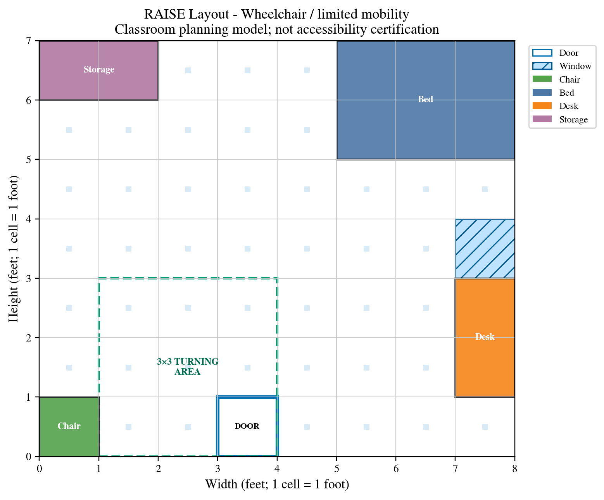
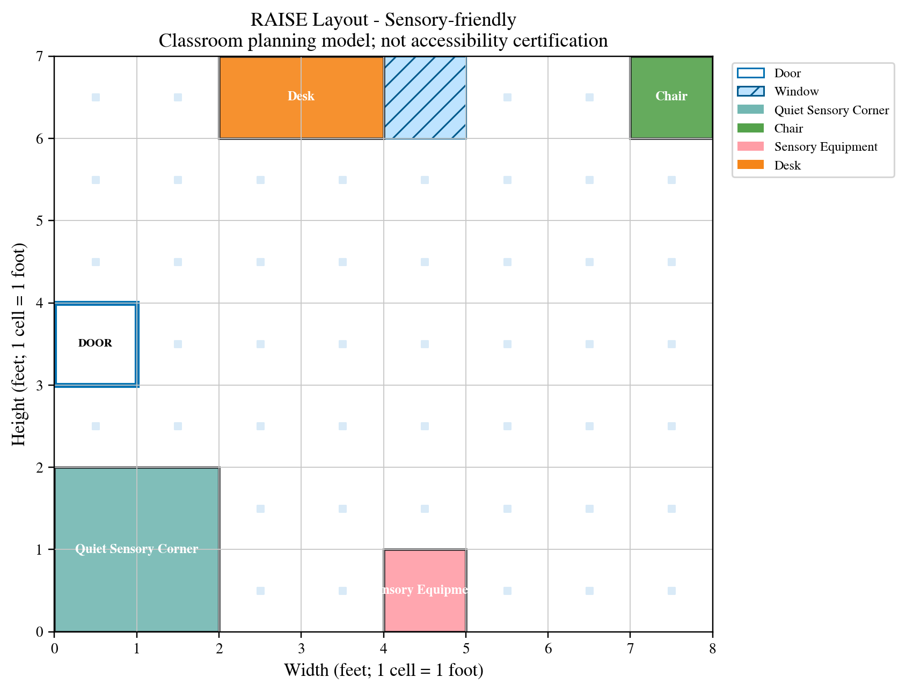
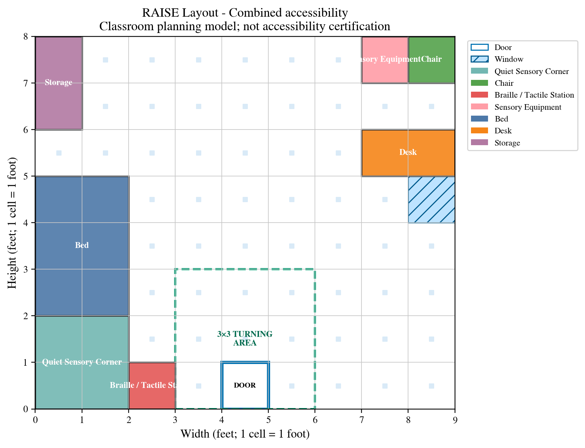
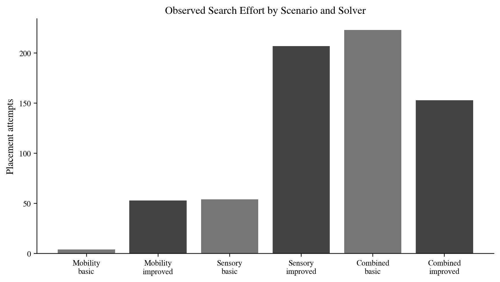
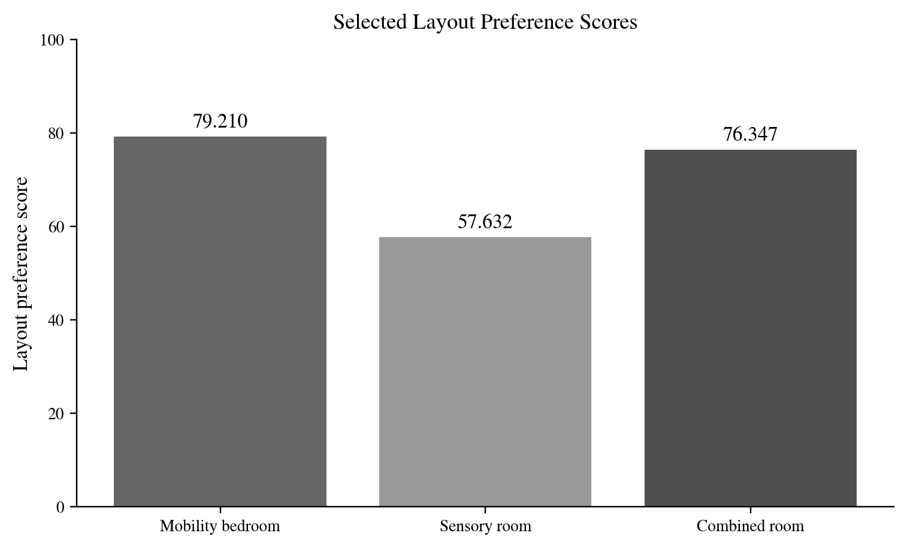

# RAISE

**Room Arrangement for Inclusive and Supportive Environments**

RAISE is an AI-assisted room-planning system that generates furniture layouts based on selected mobility, sensory, and tactile accessibility needs. It uses classical artificial intelligence to search for valid arrangements, visualize the result, and explain which requirements the arrangement satisfies.

## Why RAISE?

Room arrangement can become a repeated trial-and-error process when several needs must be considered at once. Furniture can fit within the walls while blocking the entrance, interrupting a travel path, removing open turning space, or placing a quiet area too close to stimulating equipment.

RAISE represents this task as a constraint satisfaction problem. The user provides room dimensions, fixed features, movable furniture, and an accessibility profile. The solver then searches possible positions and orientations, rejects invalid arrangements, and returns a labeled layout when it finds a solution.

## Example Layouts

### Mobility bedroom

The mobility preset preserves doorway clearance, a connected travel region, essential-item reachability, and an open turning area.

### Sensory room

The sensory preset separates a quiet corner from objects tagged as noisy or stimulating.

### Combined-accessibility room

The combined preset coordinates mobility, tactile-reach, and sensory-separation constraints in the same room.

## Features

- Built-in mobility, sensory, combined, and impossible-room presets
- Custom room-design form
- Fixed doors and windows
- Movable furniture and sensory equipment
- Furniture collision and boundary checking
- Doorway-clearance checking
- Connected travel-path checking
- Essential-furniture reachability
- Open turning-space checking
- Tactile-station access
- Separation of quiet and noisy sensory zones
- Labeled room visualization
- Constraint explanations
- Search statistics and internal layout scoring
- Separate results for invalid input, no solution, and search-limit conditions

## Accessibility Profiles

### Mobility

Checks for a usable doorway, connected travel, reachable essential furniture, and a clear turning area.

### Sensory

Checks for a designated quiet area, sufficient separation from noisy or stimulating equipment, and a valid travel path.

### Combined

Coordinates mobility, tactile-access, and sensory-separation requirements in one layout.

The profiles are simplified and editable starting points. They are not complete definitions of anyone's disability or individual accessibility needs.

## What Makes It AI?

RAISE uses classical artificial intelligence rather than machine learning.

### Constraint satisfaction

Each furniture item is a variable. Its possible positions and orientations form its domain. Spatial and accessibility requirements are represented as constraints.

### Backtracking search

The solver places furniture one item at a time. If a placement prevents the remaining requirements from being satisfied, it reverses that decision and tries another arrangement.

### Minimum remaining values

The improved search selects the unplaced item with the fewest currently valid positions first, helping expose difficult conflicts earlier.

### Forward checking

After each placement, the program checks that every remaining item still has at least one legal position.

### Breadth-first search

Breadth-first search identifies the open floor cells reachable from the doorway. This supports travel-path and furniture-reachability checks.

## How to Run RAISE

1. Click the **Open in Google Colab** badge above.
2. In Colab, select **Runtime → Run all**.
3. Wait for the setup cells to finish.
4. Run a built-in preset or complete the custom room form.
5. Review the generated layout, constraint explanations, and search statistics.

No paid software or specialized hardware is required.

## Custom Inputs

The custom form accepts:

- Room width and height
- Door coordinates
- Window coordinates
- Furniture selection
- Accessibility profile
- Basic or improved search
- Maximum number of search attempts

Coordinates begin at zero, and doors and windows must be placed on a room edge. For example, in a room with a width of 10 cells, valid horizontal coordinates run from 0 through 9.

## Furniture and Fixed Features

Doors and windows are fixed room features. The current movable-object catalog includes:

- Bed
- Desk
- Chair
- Storage unit
- Braille or tactile station
- Quiet sensory corner
- Sensory equipment

The solver searches for valid positions and orientations for movable objects while protecting the fixed features and interior doorway clearance.

## Output

For a solved room, RAISE produces:

- A labeled room-layout grid
- Furniture positions and orientations
- Reachable floor cells
- A marked turning area when required
- A list of satisfied constraints
- Search attempts and backtracking statistics
- An internal layout-preference score

If no valid arrangement exists, the program can report an exhaustive no-solution result. If the attempt budget interrupts the search, it reports a search-limit result instead of incorrectly declaring the room impossible.

## Layout Scoring

RAISE scores only layouts that already satisfy all required constraints. The internal heuristic considers furniture distribution, wall placement for beds and storage, desk proximity to a window, and open space near the center.

The score ranks valid layouts within the program. It is not a measurement of human accessibility, usability, safety, or preference.

## Evaluation Snapshots

Improved search evaluates multiple valid candidates, while basic backtracking stops after its first valid solution. These configurations therefore have different stopping rules and should not be interpreted as a simple speed competition.

The improved configuration selected higher-scoring valid layouts under the program's documented preference heuristic in the three solved presets.

## Repository Contents

- `RAISE_Room_Planner.ipynb` — interactive Google Colab notebook
- `ai_assistive_room_setup_planner_(1).py` — Python export of the notebook
- `images/` — generated layouts and evaluation figures
- `README.md` — project overview and usage instructions

## Limitations

RAISE is an academic software prototype.

- It represents rooms using simplified one-foot grid cells.
- Its profiles cover selected mobility, tactile, and sensory considerations.
- Sensory distance is a spatial approximation and does not model acoustics or individual perception.
- The software has not yet been evaluated with participants.
- Internal scores reflect designer-authored heuristics.
- Individual users may require different measurements, objects, and conditions.

RAISE does not provide architectural, medical, safety, or ADA certification.

## Future Work

Future versions could include:

- Individual requirement controls instead of broad profile labels
- Smaller measurement increments
- Door-swing and approach-direction modeling
- Reach-range and transfer-space requirements
- Multiple entrances
- Lighting and sound-source modeling
- Adjustable preference weights
- Explanations of which constraints make a room unsatisfiable
- Participatory evaluation with disabled users and relevant practitioners

## Author

**Basbo Ayelazono**  
Computer Science major with minors in Bioinformatics and Integrated Biology  
Dakota State University
